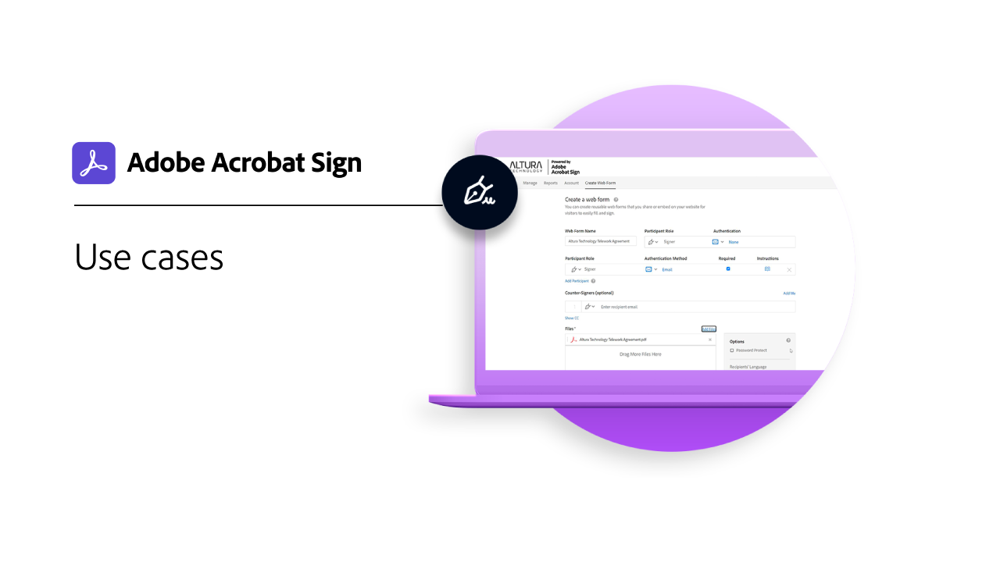

# 業界と部門の概要

これらの実際の業界や部署のユースケース、レシピ、ウェビナーを調べて、組織の電子サイン体験を変形する方法を説明します。

<table style="table-layout:fixed">
<tr>
  <td>
    
    

    <a href="innovation-series.md"><strong>スキルビルダー</strong></a>
    

    <em>30分間のスキルビルダーにご参加いただき、1日の作業を増やすことなく電子サインを活用する方法をご確認ください</em>
     
  </td>
  <td>
    
    

    <a href="recipes.md"><strong>ユースケース</strong></a>
    

    <em>様々な組織がこれらの実際の使用例を使ってAcrobat Signをどのように使っているかを調べる</em>
     
  </td>
 </td>
  <td>
    
    

     
  </td>
  <td>
    
    

     
  </td>
</tr>
</table>
